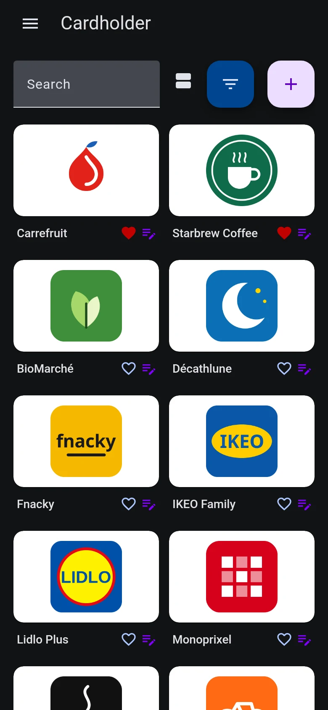

# Cardholder PWA is a self-hosted app for your loyalty and discount cards

- 🇬🇧 [English](/README.md)
- 🇩🇪 [Deutsch](/docs/de/README.md)
- 🇪🇸 [Español](/docs/es/README.md)
- 🇫🇷 [Français](/docs/fr/README.md)
- 🇮🇹 [Italiano](/docs/it/README.md)
- 🇷🇺 [Русский](/docs/ru/README.md)

<p align="center">
  
</p>

<sub>The brands, logos and codes in the screenshots are made up for the demo.</sub>

## Demo

- [Demo #1](https://cardholder-pwa.onrender.com)
- [Demo #2](https://p01--cardholder-pwa--yhc2hsmvw6xy.code.run)

It's powered by free providers and can be suspended, which will lead to a long initial load - up to a minute, according to their notes.

### Main features

- PWA - you can install it on device from browser and use even offline (read-only)
- Scan a card with the camera (torch, front/rear camera), or type the code and its type
- Most 2D and 1D codes are supported
- Logos on cards, a grid or large cards, favorites, search, sorting and filters
- Full-screen code with color inversion, to show at the checkout
- Multi-user support with owner, admin, and member roles
- Card sharing between users (one card or all at once), which the recipient accepts or declines
- Light and dark theme, following the system
- English, German, Spanish, French, Italian and Russian
- Password recovery by email (when SMTP is configured)
- Two-factor authentication with an authenticator app and one-time recovery codes
- Easy to self-host
- Open-source

### Documentation

- [Supported codes](/docs/CODES.md)
- [Two-factor authentication](/docs/TWO_FACTOR.md)
- [Encryption](/docs/ENCRYPTION.md)
- [Account roles](/docs/ROLES.md)
- [Shared cards](/docs/SHARED_CARDS.md)
- [Contributing](/docs/CONTRIBUTING.md)
- [Security](/docs/SECURITY.md)

### Screenshots

|                           Cards                            |                           Code                            |                        Card editor                        |                           Sharing                           |
| :--------------------------------------------------------: | :-------------------------------------------------------: | :-------------------------------------------------------: | :---------------------------------------------------------: |
|  |  |  |  |

|                          Sign in                           |                           Large cards                            |                              Admin                              |                           Dark theme                            |
| :--------------------------------------------------------: | :--------------------------------------------------------------: | :-------------------------------------------------------------: | :-------------------------------------------------------------: |
|  |  |  |  |

### Preparation

- **Environment variables** are not required, but you can still define some. There is [.env.example](/.env.example) containing list of vars with description. I’d recommend setting up at least **SMTP** to enable password recovery, and **MASTER_KEY** if you want two-factor authentication. See [Encryption](/docs/ENCRYPTION.md).
- For **PWA** and **video-stream** code scanner functionality you need **HTTPS** access. I use a separate Nginx with Let's Encrypt certificate.

### Deploy

- Using `docker`

```bash
# pull image
docker pull ghcr.io/quenary/cardholder_pwa:1

# run container
docker run -d -p 80:80 \
-v $HOME/.cardholder_pwa:/cardholder_pwa \
ghcr.io/quenary/cardholder_pwa:1
```

- Using `docker-compose`

```bash
# place one of the docker-compose files to desired location (or in Portainer)
# docker-compose.sqlite.yml - for local sqlite db
# docker-compose.pg.yml | docker-compose.my.yml - for full-featured db (separate container in the app network by default)
docker-compose -f <filename> up -d
```
