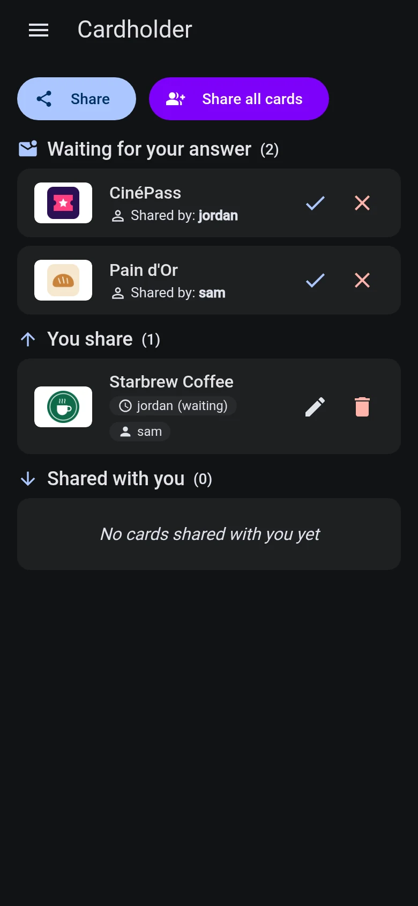

# Shared Cards

Cardholder allows users on the same instance to share loyalty cards with each other (e.g. family or team members).

  
  

## Managing Shares

Open **Shared cards** (`/cards/shared`) from the side menu:

- **Share card**: Select a card and choose which users can access it.
- **Share all cards**: Grant access to your entire card collection to selected users at once.  
  *Note: this replaces the recipients of all your cards. Recipients who stay on the list keep their answer.*
- **Edit or revoke**: In the **"You share"** list, use the pencil icon to update recipients or the trash icon to revoke sharing. Each recipient shows whether they are still waiting to answer or declined.

## Answering a Share

A card someone shares with you is not added to your list until you accept it. The menu entry shows a dot while shares are waiting for you.

- **Waiting for your answer**: accept (check mark) or decline (cross) each card.
- **Declined**: cards you declined, or removed from your list, stay here and can still be accepted. The owner sharing them again does not ask you twice.
- **Shared with you**: the cards you accepted. Use the trash icon to remove one from your view (it moves to **Declined** and does not affect the owner).

## Using Shared Cards

Accepted cards appear on the main screen (`/cards`) under the **"Shared with you"** section:

- Marked with a group icon (`group`).
- Tapping a card opens its barcode or QR code full-screen for scanning.
- Cards are **read-only** (cannot be edited, deleted, or re-shared by recipients).
- Fully supports search, filtering, and sorting alongside your personal cards.
