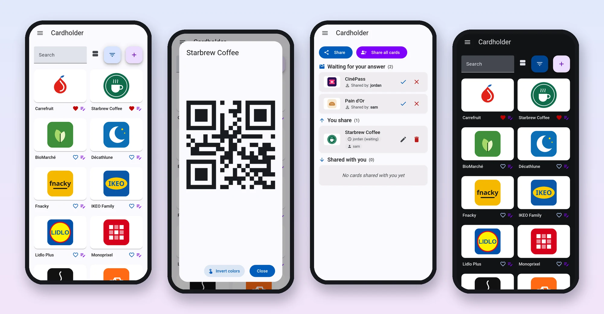

# Cardholder PWA ist eine selbst gehostete Anwendung für Ihre Kunden- und Rabattkarten

- 🇬🇧 [English](/README.md)
- 🇩🇪 [Deutsch](/docs/de/README.md)
- 🇪🇸 [Español](/docs/es/README.md)
- 🇫🇷 [Français](/docs/fr/README.md)
- 🇮🇹 [Italiano](/docs/it/README.md)
- 🇷🇺 [Русский](/docs/ru/README.md)

<p align="center">
  
</p>

<sub>Marken, Logos und Codes in den Screenshots sind für die Demo erfunden.</sub>

## Demo

- [Demo #1](https://cardholder-pwa.onrender.com)
- [Demo #2](https://p01--cardholder-pwa--yhc2hsmvw6xy.code.run)

Sie laufen bei kostenlosen Anbietern, die Container aussetzen können. Der erste Aufruf kann deshalb lange dauern, nach deren Angaben bis zu einer Minute.

### Wichtigste Funktionen

- PWA – lässt sich aus dem Browser auf dem Gerät installieren und auch offline nutzen (nur lesend)
- Karten mit der Kamera scannen (Taschenlampe, Front-/Rückkamera) oder Code und Typ eingeben
- Die meisten 2D- und 1D-Codes werden unterstützt
- Logos auf den Karten, als Raster oder große Karten, Favoriten, Suche, Sortierung und Filter
- Code im Vollbild mit Farbumkehr, zum Vorzeigen an der Kasse
- Mehrbenutzerbetrieb mit den Rollen Besitzer, Administrator und Mitglied
- Karten mit anderen Benutzern teilen (eine oder alle auf einmal); der Empfänger nimmt an oder lehnt ab
- Helles und dunkles Design, je nach System
- Englisch, Deutsch, Spanisch, Französisch, Italienisch und Russisch
- Passwort-Wiederherstellung per E-Mail (wenn SMTP eingerichtet ist)
- Zwei-Faktor-Authentifizierung mit Authenticator-App und einmaligen Wiederherstellungscodes
- Einfach selbst zu hosten
- Open Source

### Dokumentation

Diese Dokumente gibt es nur auf Englisch:

- [Unterstützte Codes](/docs/CODES.md)
- [Zwei-Faktor-Authentifizierung](/docs/TWO_FACTOR.md)
- [Verschlüsselung](/docs/ENCRYPTION.md)
- [Kontenrollen](/docs/ROLES.md)
- [Geteilte Karten](/docs/SHARED_CARDS.md)
- [Contributing](/docs/CONTRIBUTING.md)
- [Security](/docs/SECURITY.md)

### Screenshots

|                              Karten                              |                              Code                               |                           Bearbeiten                            |                              Teilen                               |
| :--------------------------------------------------------------: | :-------------------------------------------------------------: | :-------------------------------------------------------------: | :---------------------------------------------------------------: |
|  |  |  |  |

|                            Anmeldung                             |                              Große Karten                              |                                 Admin                                 |                            Dunkles Design                             |
| :--------------------------------------------------------------: | :--------------------------------------------------------------------: | :-------------------------------------------------------------------: | :-------------------------------------------------------------------: |
|  |  |  |  |

### Vorbereitung

- **Umgebungsvariablen** sind nicht erforderlich, Sie können aber welche setzen. In [.env.example](/.env.example) sind alle mit Beschreibung aufgeführt. Ich empfehle, mindestens **SMTP** einzurichten, damit das Zurücksetzen des Passworts funktioniert, und **MASTER_KEY**, wenn Sie die Zwei-Faktor-Authentifizierung nutzen möchten. Siehe [Verschlüsselung](/docs/ENCRYPTION.md).
- Für die **PWA** und den Scanner über den **Videostream** ist ein Zugriff über **HTTPS** nötig. Ich verwende dafür ein eigenes Nginx mit einem Let's-Encrypt-Zertifikat.

### Bereitstellung

- Mit `docker`

```bash
# Image holen
docker pull ghcr.io/quenary/cardholder_pwa:1

# Container starten
docker run -d -p 80:80 \
-v $HOME/.cardholder_pwa:/cardholder_pwa \
ghcr.io/quenary/cardholder_pwa:1
```

- Mit `docker-compose`

```bash
# eine der docker-compose-Dateien an den gewuenschten Ort legen (oder in Portainer)
# docker-compose.sqlite.yml - fuer eine lokale sqlite-Datenbank
# docker-compose.pg.yml | docker-compose.my.yml - fuer eine vollwertige Datenbank (standardmaessig eigener Container im Netz der App)
docker-compose -f <Datei> up -d
```
