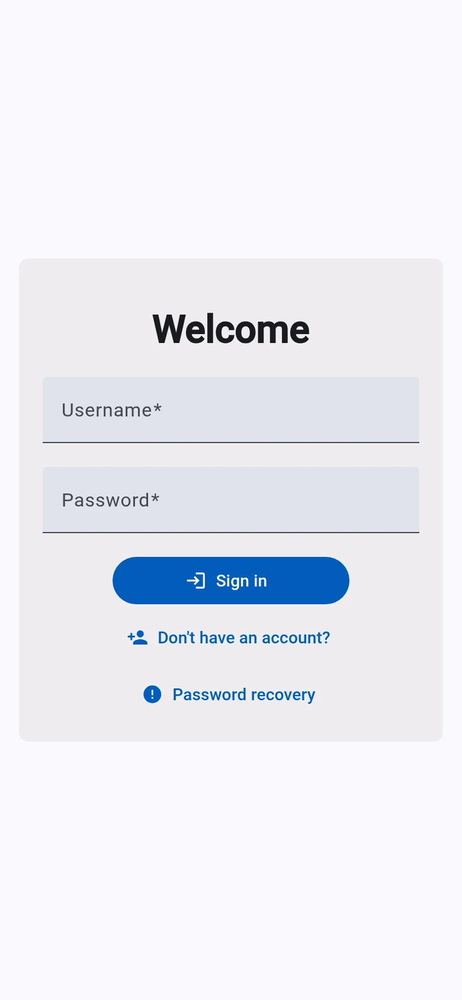
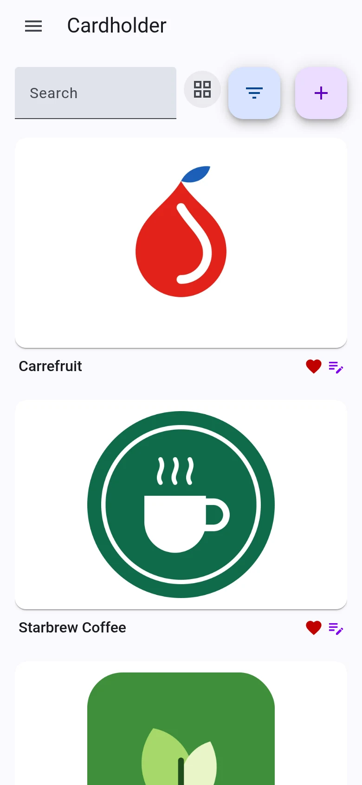

# Cardholder PWA es una aplicación autoalojada para tus tarjetas de fidelidad y de descuento

- 🇬🇧 [English](/README.md)
- 🇩🇪 [Deutsch](/docs/de/README.md)
- 🇪🇸 [Español](/docs/es/README.md)
- 🇫🇷 [Français](/docs/fr/README.md)
- 🇮🇹 [Italiano](/docs/it/README.md)
- 🇷🇺 [Русский](/docs/ru/README.md)

<p align="center">
  
</p>

<sub>Las marcas, logotipos y códigos de las capturas son inventados para la demo.</sub>

## Demostración

- [Demo #1](https://cardholder-pwa.onrender.com)
- [Demo #2](https://p01--cardholder-pwa--yhc2hsmvw6xy.code.run)

Están alojadas en proveedores gratuitos, que pueden suspender los contenedores. La primera carga puede tardar, hasta un minuto según ellos.

### Funciones principales

- PWA: se instala en el dispositivo desde el navegador y funciona incluso sin conexión (solo lectura)
- Escaneo de tarjetas con la cámara (linterna, cámara delantera/trasera) o introducción manual del código y su tipo
- Se admiten la mayoría de los códigos 2D y 1D
- Logotipos en las tarjetas, en cuadrícula o en tamaño grande, favoritos, búsqueda, orden y filtros
- Código a pantalla completa con inversión de colores, para mostrarlo en caja
- Varios usuarios con los roles de propietario, administrador y miembro
- Compartir tarjetas entre usuarios (una o todas a la vez), que el destinatario acepta o rechaza
- Tema claro y oscuro, según el sistema
- Inglés, alemán, español, francés, italiano y ruso
- Recuperación de contraseña por correo (si SMTP está configurado)
- Autenticación en dos pasos con una aplicación de autenticación y códigos de recuperación de un solo uso
- Fácil de autoalojar
- Código abierto

### Documentación

Estos documentos están solo en inglés:

- [Códigos compatibles](/docs/CODES.md)
- [Autenticación en dos pasos](/docs/TWO_FACTOR.md)
- [Cifrado](/docs/ENCRYPTION.md)
- [Roles de las cuentas](/docs/ROLES.md)
- [Tarjetas compartidas](/docs/SHARED_CARDS.md)
- [Contributing](/docs/CONTRIBUTING.md)
- [Security](/docs/SECURITY.md)

### Capturas de pantalla

|                             Tarjetas                             |                             Código                              |                             Edición                             |                             Compartir                             |
| :--------------------------------------------------------------: | :-------------------------------------------------------------: | :-------------------------------------------------------------: | :---------------------------------------------------------------: |
|  |  |  |  |

|                         Inicio de sesión                         |                            Tarjetas grandes                            |                                 Admin                                 |                              Tema oscuro                              |
| :--------------------------------------------------------------: | :--------------------------------------------------------------------: | :-------------------------------------------------------------------: | :-------------------------------------------------------------------: |
|  |  |  |  |

### Preparación

- Las **variables de entorno** no son obligatorias, pero puedes definir algunas. El archivo [.env.example](/.env.example) las enumera todas con su descripción. Recomiendo configurar al menos **SMTP**, para habilitar la recuperación de contraseña, y **MASTER_KEY** si quieres la autenticación en dos pasos. Consulta [Cifrado](/docs/ENCRYPTION.md).
- La **PWA** y el escáner por **flujo de vídeo** necesitan acceso por **HTTPS**. Yo uso un Nginx aparte con un certificado de Let's Encrypt.

### Despliegue

- Con `docker`

```bash
# descargar la imagen
docker pull ghcr.io/quenary/cardholder_pwa:1

# ejecutar el contenedor
docker run -d -p 80:80 \
-v $HOME/.cardholder_pwa:/cardholder_pwa \
ghcr.io/quenary/cardholder_pwa:1
```

- Con `docker-compose`

```bash
# coloca uno de los archivos docker-compose donde quieras (o en Portainer)
# docker-compose.sqlite.yml - para una base sqlite local
# docker-compose.pg.yml | docker-compose.my.yml - para una base completa (contenedor aparte en la red de la app por defecto)
docker-compose -f <archivo> up -d
```
