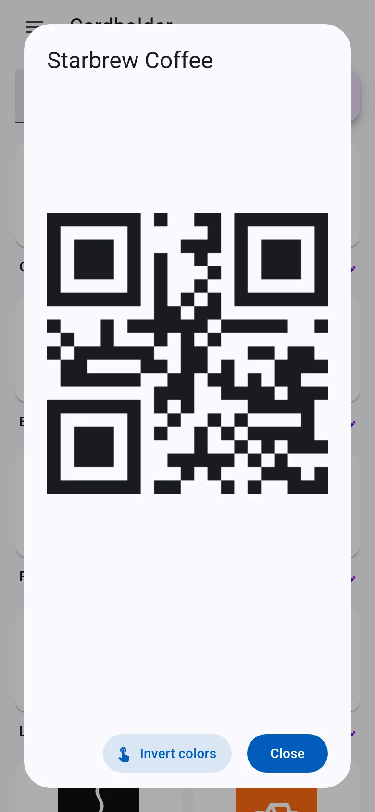

# Cardholder PWA est une application auto-hébergée pour vos cartes de fidélité et de réduction

- 🇬🇧 [English](/README.md)
- 🇩🇪 [Deutsch](/docs/de/README.md)
- 🇪🇸 [Español](/docs/es/README.md)
- 🇫🇷 [Français](/docs/fr/README.md)
- 🇮🇹 [Italiano](/docs/it/README.md)
- 🇷🇺 [Русский](/docs/ru/README.md)

<p align="center">
  
</p>

<sub>Les enseignes, logos et codes des captures sont inventés pour la démo.</sub>

## Démo

- [Démo #1](https://cardholder-pwa.onrender.com)
- [Démo #2](https://p01--cardholder-pwa--yhc2hsmvw6xy.code.run)

Elles tournent chez des hébergeurs gratuits, qui peuvent suspendre les conteneurs. Le premier chargement peut donc être long, jusqu'à une minute d'après eux.

### Principales fonctionnalités

- PWA, installable sur l'appareil depuis le navigateur et utilisable même hors ligne (en lecture seule)
- Scan d'une carte à la caméra (lampe, caméra avant/arrière), ou saisie du code et de son type
- Logos sur les cartes, en grille ou en grand format, favoris, recherche, tri et filtres
- Code en plein écran avec inversion des couleurs, à présenter en caisse
- Multi-utilisateur, avec les rôles propriétaire, administrateur et membre
- Partage de cartes entre utilisateurs (une carte ou toutes d'un coup), que le destinataire accepte ou refuse
- Thème clair et sombre, selon le système
- Anglais, allemand, espagnol, français, italien et russe
- Récupération du mot de passe par e-mail (si SMTP est configuré)
- Authentification à deux facteurs avec une application d'authentification et des codes de récupération à usage unique
- Simple à auto-héberger
- Open source

### Captures d'écran

|                              Cartes                              |                              Code                               |                             Édition                             |                              Partage                              |
| :--------------------------------------------------------------: | :-------------------------------------------------------------: | :-------------------------------------------------------------: | :---------------------------------------------------------------: |
|  |  |  |  |

|                            Connexion                             |                             Grandes cartes                             |                                 Admin                                 |                             Thème sombre                              |
| :--------------------------------------------------------------: | :--------------------------------------------------------------------: | :-------------------------------------------------------------------: | :-------------------------------------------------------------------: |
|  |  |  |  |

### Technologies

- Angular pour le frontend
- Python avec FastAPI et SQLAlchemy pour le backend

### Codes pris en charge

- En résumé, les principaux types 2D (le QR code par exemple) et 1D (le code-barres par exemple).
- L'application s'appuie sur :
  - [zxing-js/browser](https://github.com/zxing-js/browser) et [quagga2](https://github.com/ericblade/quagga2) pour la lecture des codes.
  - [bwip-js](https://github.com/metafloor/bwip-js) pour leur affichage.
- Codes pris en charge :
  - [Types de `zxing-js`](https://github.com/zxing-js/library?tab=readme-ov-file#supported-formats)
  - [Types de `quagga2`](https://github.com/ericblade/quagga2/tree/master/src/reader)
  - [Types de `bwip-js`](https://github.com/metafloor/bwip-js/wiki/BWIPP-Barcode-Types)
- Vous pouvez saisir la valeur et le type du code à la main : `bwip-js` l'affichera s'il le prend en charge.
- J'ai remarqué que `zxing` a du mal à détecter les codes clairs sur fond sombre. Les autres lecteurs sont peut-être concernés aussi.

### Préparation

- Les **variables d'environnement** ne sont pas obligatoires, mais vous pouvez en définir. Le fichier [.env.example](/.env.example) les liste toutes avec leur description. Je recommande de configurer au moins **SMTP**, pour activer la récupération du mot de passe, et **MASTER_KEY** si vous voulez l'authentification à deux facteurs.
- **MASTER_KEY** est la clé générale des secrets stockés. Elle ne sert aujourd'hui qu'à l'authentification à deux facteurs : le secret TOTP et la clé qui calcule le HMAC des codes de récupération. Générez-la avec `openssl rand -base64 32` et conservez une copie ailleurs que dans la sauvegarde de la base. Sans elle, les utilisateurs ne peuvent pas activer la 2FA. La changer ou la perdre rend les secrets et les codes déjà enregistrés inutilisables ; un administrateur doit réinitialiser ces utilisateurs (ou le propriétaire peut utiliser le SQL ci-dessous). La rotation de la clé n'est pas encore prise en charge. Un outil ultérieur aura besoin du préfixe `v1:` du texte chiffré stocké.
- Le fonctionnement de la **PWA** et du scanner par **flux vidéo** demande un accès en **HTTPS**. J'utilise un Nginx séparé avec un certificat Let's Encrypt.

### Authentification à deux facteurs

Sur la page utilisateur, choisissez **Activer la 2FA**, scannez le QR code avec une application d'authentification et confirmez avec votre mot de passe et un code à 6 chiffres. L'application affiche alors dix codes de récupération, une seule fois. Chaque code ne fonctionne qu'une fois si vous perdez l'authentificateur. Un administrateur ou le propriétaire peut réinitialiser la 2FA d'un autre utilisateur depuis le dialogue d'administration de cet utilisateur (pas la sienne, ni celle du propriétaire). Si le propriétaire perd l'authentificateur et tous les codes de récupération, le seul recours est du SQL sur la base :

```sql
UPDATE users SET two_factor_secret = NULL, two_factor_enabled_at = NULL, two_factor_last_step = NULL, two_factor_failed_attempts = 0, two_factor_locked_until = NULL WHERE username = '<name>';
DELETE FROM two_factor_recovery_codes WHERE user_id = (SELECT id FROM users WHERE username = '<name>');
```

### Déploiement

- Avec `docker`

```bash
# recuperer l'image
docker pull ghcr.io/quenary/cardholder_pwa:1

# lancer le conteneur
docker run -d -p 80:80 \
-v $HOME/.cardholder_pwa:/cardholder_pwa \
ghcr.io/quenary/cardholder_pwa:1
```

- Avec `docker-compose`

```bash
# placez l'un des fichiers docker-compose a l'endroit voulu (ou dans Portainer)
# docker-compose.sqlite.yml - pour une base sqlite locale
# docker-compose.pg.yml | docker-compose.my.yml - pour une base complete (conteneur separe dans le reseau de l'app par defaut)
docker-compose -f <fichier> up -d
```

### Rôles des comptes

- **Le premier compte enregistré** (après le déploiement ou la migration depuis la version 0.0.13) reçoit le rôle **propriétaire**. Pour l'instant ce compte ne peut pas être supprimé, et le rôle de propriétaire ne peut pas être réattribué de manière pratique.
- C'est peut-être excessif, mais j'ai aussi ajouté les rôles administrateur et membre, au cas où.
- Le **propriétaire** peut :
  - Modifier certains réglages de l'application depuis l'interface
  - Attribuer le rôle d'administrateur à d'autres membres
  - Supprimer des comptes administrateurs ou membres
- L'**administrateur** peut :
  - Modifier certains réglages de l'application depuis l'interface
  - Supprimer des comptes membres

### Cartes partagées

Voir [docs/SHARED_CARDS.md](/docs/SHARED_CARDS.md).

### Contribution et sécurité

Ces documents sont uniquement en anglais :

- [Contributing](/docs/CONTRIBUTING.md)
- [Security](/docs/SECURITY.md)
