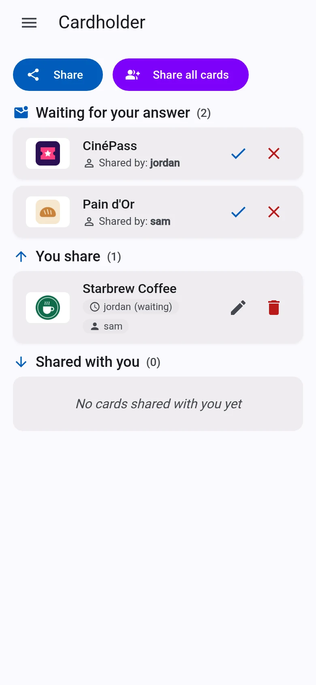

# Cardholder PWA è un'applicazione self-hosted per le tue carte fedeltà e sconto

- 🇬🇧 [English](/README.md)
- 🇩🇪 [Deutsch](/docs/de/README.md)
- 🇪🇸 [Español](/docs/es/README.md)
- 🇫🇷 [Français](/docs/fr/README.md)
- 🇮🇹 [Italiano](/docs/it/README.md)
- 🇷🇺 [Русский](/docs/ru/README.md)

<p align="center">
  
</p>

<sub>Marchi, loghi e codici negli screenshot sono inventati per la demo.</sub>

## Demo

- [Demo #1](https://cardholder-pwa.onrender.com)
- [Demo #2](https://p01--cardholder-pwa--yhc2hsmvw6xy.code.run)

Sono ospitate su servizi gratuiti, che possono sospendere i container. Il primo caricamento può quindi essere lento, fino a un minuto secondo le loro note.

### Funzionalità principali

- PWA: si installa sul dispositivo dal browser e funziona anche offline (sola lettura)
- Scansione delle carte con la fotocamera (torcia, fotocamera anteriore/posteriore) o inserimento manuale del codice e del tipo
- Loghi sulle carte, in griglia o in formato grande, preferiti, ricerca, ordinamento e filtri
- Codice a schermo intero con inversione dei colori, da mostrare alla cassa
- Più utenti con i ruoli di proprietario, amministratore e membro
- Condivisione delle carte tra utenti (una o tutte insieme), che il destinatario accetta o rifiuta
- Tema chiaro e scuro, in base al sistema
- Inglese, tedesco, spagnolo, francese, italiano e russo
- Recupero della password via e-mail (se SMTP è configurato)
- Autenticazione a due fattori con un'app di autenticazione e codici di recupero usa e getta
- Facile da ospitare in proprio
- Open source

### Screenshot

|                              Carte                               |                             Codice                              |                            Modifica                             |                           Condivisione                            |
| :--------------------------------------------------------------: | :-------------------------------------------------------------: | :-------------------------------------------------------------: | :---------------------------------------------------------------: |
|  |  |  |  |

|                             Accesso                              |                              Carte grandi                              |                                 Admin                                 |                              Tema scuro                               |
| :--------------------------------------------------------------: | :--------------------------------------------------------------------: | :-------------------------------------------------------------------: | :-------------------------------------------------------------------: |
|  |  |  |  |

### Tecnologie

- Angular per il frontend
- Python con FastAPI e SQLAlchemy per il backend

### Codici supportati

- In breve, i principali tipi 2D (per esempio il codice QR) e 1D (per esempio il codice a barre).
- L'applicazione si basa su:
  - [zxing-js/browser](https://github.com/zxing-js/browser) e [quagga2](https://github.com/ericblade/quagga2) per la lettura dei codici.
  - [bwip-js](https://github.com/metafloor/bwip-js) per mostrarli.
- Codici supportati:
  - [Tipi di `zxing-js`](https://github.com/zxing-js/library?tab=readme-ov-file#supported-formats)
  - [Tipi di `quagga2`](https://github.com/ericblade/quagga2/tree/master/src/reader)
  - [Tipi di `bwip-js`](https://github.com/metafloor/bwip-js/wiki/BWIPP-Barcode-Types)
- Puoi inserire a mano il valore e il tipo del codice: `bwip-js` lo mostrerà, se lo supporta.
- Ho notato che `zxing` fatica a rilevare codici chiari su sfondo scuro. Forse la cosa riguarda anche gli altri lettori.

### Preparazione

- Le **variabili d'ambiente** non sono obbligatorie, ma puoi impostarne alcune. Il file [.env.example](/.env.example) le elenca tutte con la relativa descrizione. Consiglio di configurare almeno **SMTP**, per abilitare il recupero della password, e **MASTER_KEY** se vuoi l'autenticazione a due fattori.
- **MASTER_KEY** è la chiave generale dei segreti conservati. Oggi serve solo all'autenticazione a due fattori: il segreto TOTP e la chiave con cui si calcola l'HMAC dei codici di recupero. Generala con `openssl rand -base64 32` e tienine una copia separata dal backup del database. Senza di essa gli utenti non possono attivare la 2FA. Cambiarla o perderla rende inutilizzabili i segreti e i codici già salvati; un amministratore deve reimpostare quegli utenti (oppure il proprietario può usare l'SQL qui sotto). La rotazione della chiave non è ancora supportata. Uno strumento futuro avrà bisogno del prefisso `v1:` del testo cifrato salvato.
- La **PWA** e lo scanner tramite **flusso video** richiedono un accesso in **HTTPS**. Io uso un Nginx separato con un certificato Let's Encrypt.

### Autenticazione a due fattori

Nella pagina utente scegli **Attiva la 2FA**, scansiona il codice QR con un'app di autenticazione e conferma con la password e un codice di 6 cifre. L'applicazione mostra quindi dieci codici di recupero, una sola volta. Ogni codice funziona una volta sola se perdi l'autenticatore. Un amministratore o il proprietario può reimpostare la 2FA di un altro utente dal dialogo di amministrazione di quell'utente (non la propria e non quella del proprietario). Se il proprietario perde l'autenticatore e tutti i codici di recupero, l'unica via è SQL sul database:

```sql
UPDATE users SET two_factor_secret = NULL, two_factor_enabled_at = NULL, two_factor_last_step = NULL, two_factor_failed_attempts = 0, two_factor_locked_until = NULL WHERE username = '<name>';
DELETE FROM two_factor_recovery_codes WHERE user_id = (SELECT id FROM users WHERE username = '<name>');
```

### Distribuzione

- Con `docker`

```bash
# scaricare l'immagine
docker pull ghcr.io/quenary/cardholder_pwa:1

# avviare il container
docker run -d -p 80:80 \
-v $HOME/.cardholder_pwa:/cardholder_pwa \
ghcr.io/quenary/cardholder_pwa:1
```

- Con `docker-compose`

```bash
# posiziona uno dei file docker-compose dove preferisci (o in Portainer)
# docker-compose.sqlite.yml - per un database sqlite locale
# docker-compose.pg.yml | docker-compose.my.yml - per un database completo (container separato nella rete dell'app per impostazione predefinita)
docker-compose -f <file> up -d
```

### Ruoli degli account

- **Il primo account registrato** (dopo la distribuzione o la migrazione dalla versione 0.0.13) riceve il ruolo di **proprietario**. Per ora questo account non può essere eliminato, e il ruolo di proprietario non può essere riassegnato in modo comodo.
- Forse è eccessivo, ma per sicurezza ho aggiunto anche i ruoli di amministratore e membro.
- Il **proprietario** può:
  - Modificare alcune impostazioni dell'applicazione dall'interfaccia
  - Assegnare il ruolo di amministratore ad altri membri
  - Eliminare account di amministratori o membri
- L'**amministratore** può:
  - Modificare alcune impostazioni dell'applicazione dall'interfaccia
  - Eliminare account di membri

### Carte condivise

Vedi [docs/SHARED_CARDS.md](/docs/SHARED_CARDS.md).

### Contribuire e sicurezza

Questi documenti sono solo in inglese:

- [Contributing](/docs/CONTRIBUTING.md)
- [Security](/docs/SECURITY.md)
