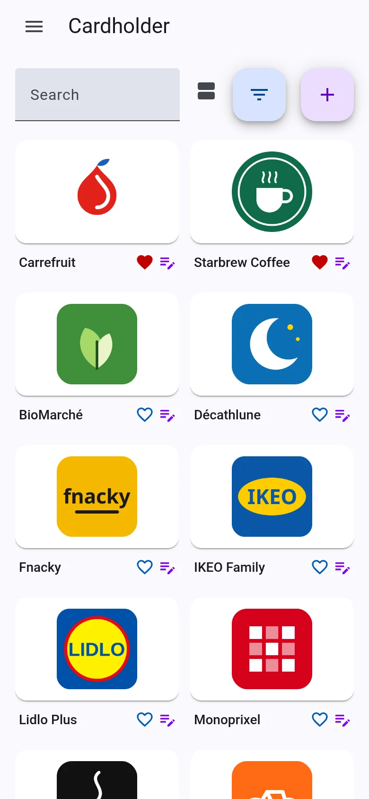
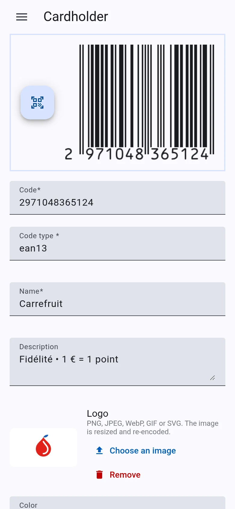
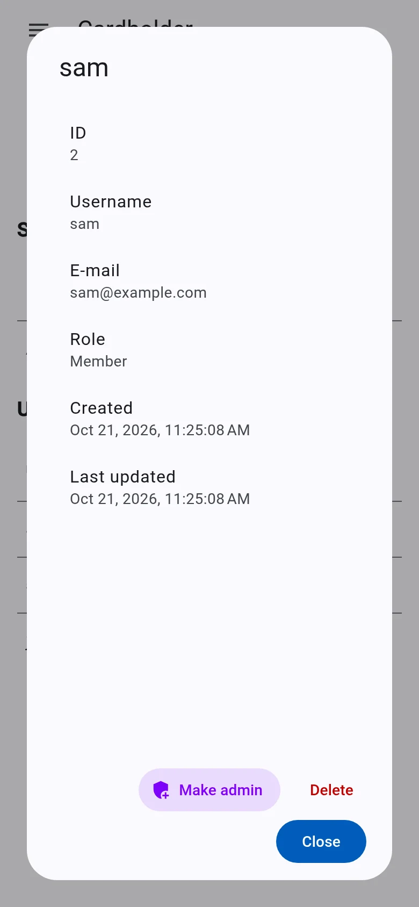

# Cardholder PWA è un'applicazione self-hosted per le tue carte fedeltà e sconto

- 🇬🇧 [English](/README.md)
- 🇩🇪 [Deutsch](/docs/de/README.md)
- 🇪🇸 [Español](/docs/es/README.md)
- 🇫🇷 [Français](/docs/fr/README.md)
- 🇮🇹 [Italiano](/docs/it/README.md)
- 🇷🇺 [Русский](/docs/ru/README.md)

<p align="center">
  
</p>

<sub>Marchi, loghi e codici negli screenshot sono inventati per la demo.</sub>

## Demo

- [Demo #1](https://cardholder-pwa.onrender.com)
- [Demo #2](https://p01--cardholder-pwa--yhc2hsmvw6xy.code.run)

Sono ospitate su servizi gratuiti, che possono sospendere i container. Il primo caricamento può quindi essere lento, fino a un minuto secondo le loro note.

### Funzionalità principali

- PWA: si installa sul dispositivo dal browser e funziona anche offline (sola lettura)
- Scansione delle carte con la fotocamera (torcia, fotocamera anteriore/posteriore) o inserimento manuale del codice e del tipo
- Sono supportati la maggior parte dei codici 2D e 1D
- Loghi sulle carte, in griglia o in formato grande, preferiti, ricerca, ordinamento e filtri
- Codice a schermo intero con inversione dei colori, da mostrare alla cassa
- Più utenti con i ruoli di proprietario, amministratore e membro
- Condivisione delle carte tra utenti (una o tutte insieme), che il destinatario accetta o rifiuta
- Tema chiaro e scuro, in base al sistema
- Inglese, tedesco, spagnolo, francese, italiano e russo
- Recupero della password via e-mail (se SMTP è configurato)
- Autenticazione a due fattori con un'app di autenticazione e codici di recupero usa e getta
- Facile da ospitare in proprio
- Open source

### Documentazione

Questi documenti sono solo in inglese:

- [Codici supportati](/docs/CODES.md)
- [Autenticazione a due fattori](/docs/TWO_FACTOR.md)
- [Crittografia](/docs/ENCRYPTION.md)
- [Ruoli degli account](/docs/ROLES.md)
- [Carte condivise](/docs/SHARED_CARDS.md)
- [Contributing](/docs/CONTRIBUTING.md)
- [Security](/docs/SECURITY.md)

### Screenshot

|                              Carte                               |                             Codice                              |                            Modifica                             |                           Condivisione                            |
| :--------------------------------------------------------------: | :-------------------------------------------------------------: | :-------------------------------------------------------------: | :---------------------------------------------------------------: |
|  |  |  |  |

|                             Accesso                              |                              Carte grandi                              |                                 Admin                                 |                              Tema scuro                               |
| :--------------------------------------------------------------: | :--------------------------------------------------------------------: | :-------------------------------------------------------------------: | :-------------------------------------------------------------------: |
|  |  |  |  |

### Preparazione

- Le **variabili d'ambiente** non sono obbligatorie, ma puoi impostarne alcune. Il file [.env.example](/.env.example) le elenca tutte con la relativa descrizione. Consiglio di configurare almeno **SMTP**, per abilitare il recupero della password, e **MASTER_KEY** se vuoi l'autenticazione a due fattori. Vedi [Crittografia](/docs/ENCRYPTION.md).
- La **PWA** e lo scanner tramite **flusso video** richiedono un accesso in **HTTPS**. Io uso un Nginx separato con un certificato Let's Encrypt.

### Distribuzione

- Con `docker`

```bash
# scaricare l'immagine
docker pull ghcr.io/quenary/cardholder_pwa:1

# avviare il container
docker run -d -p 80:80 \
-v $HOME/.cardholder_pwa:/cardholder_pwa \
ghcr.io/quenary/cardholder_pwa:1
```

- Con `docker-compose`

```bash
# posiziona uno dei file docker-compose dove preferisci (o in Portainer)
# docker-compose.sqlite.yml - per un database sqlite locale
# docker-compose.pg.yml | docker-compose.my.yml - per un database completo (container separato nella rete dell'app per impostazione predefinita)
docker-compose -f <file> up -d
```
